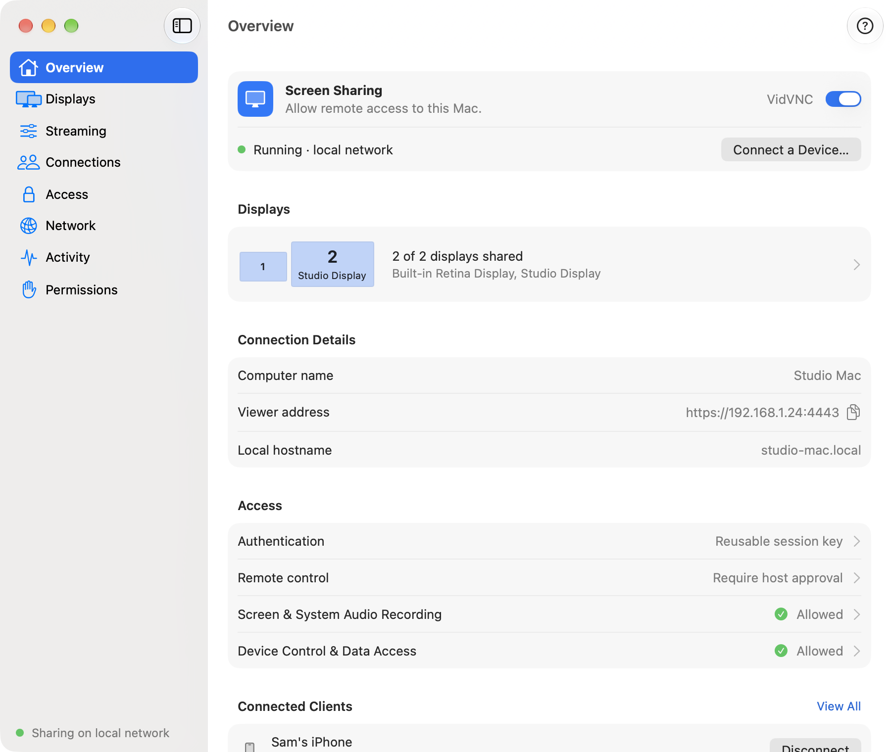
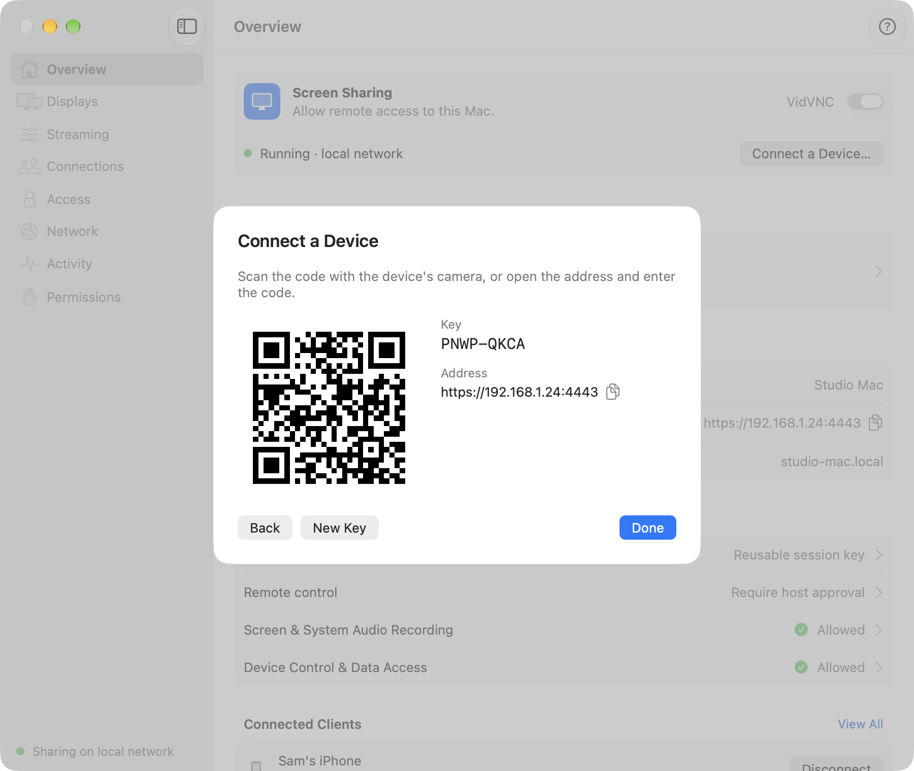
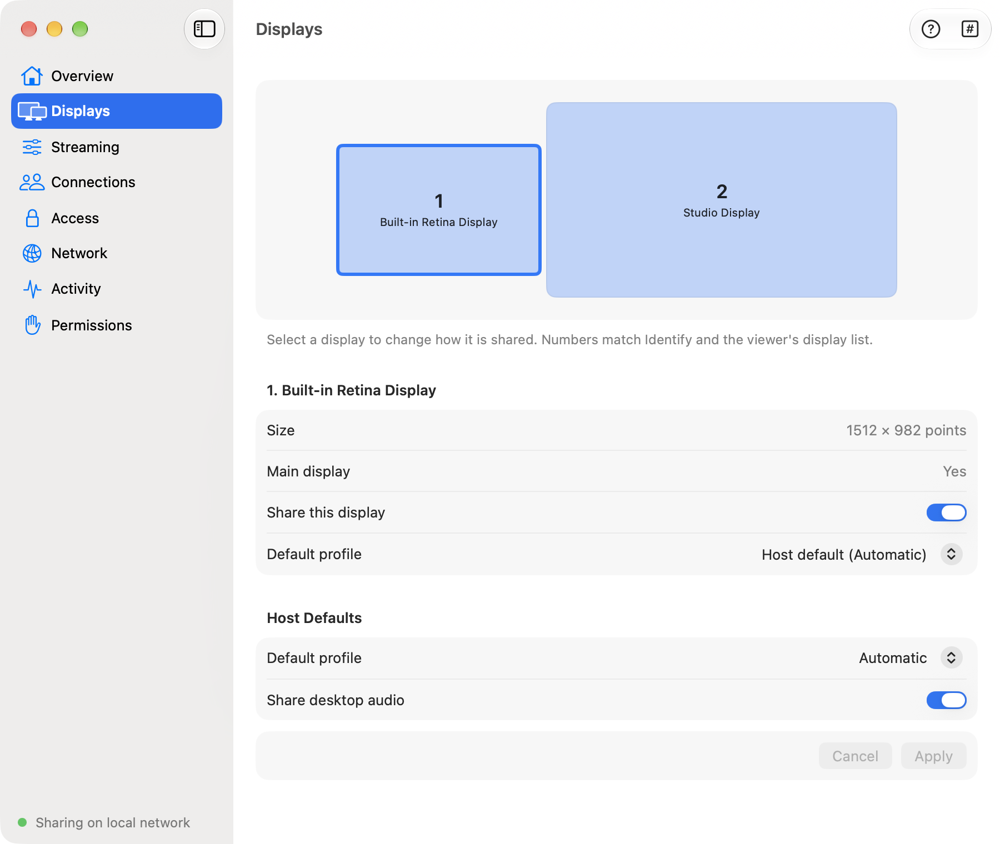
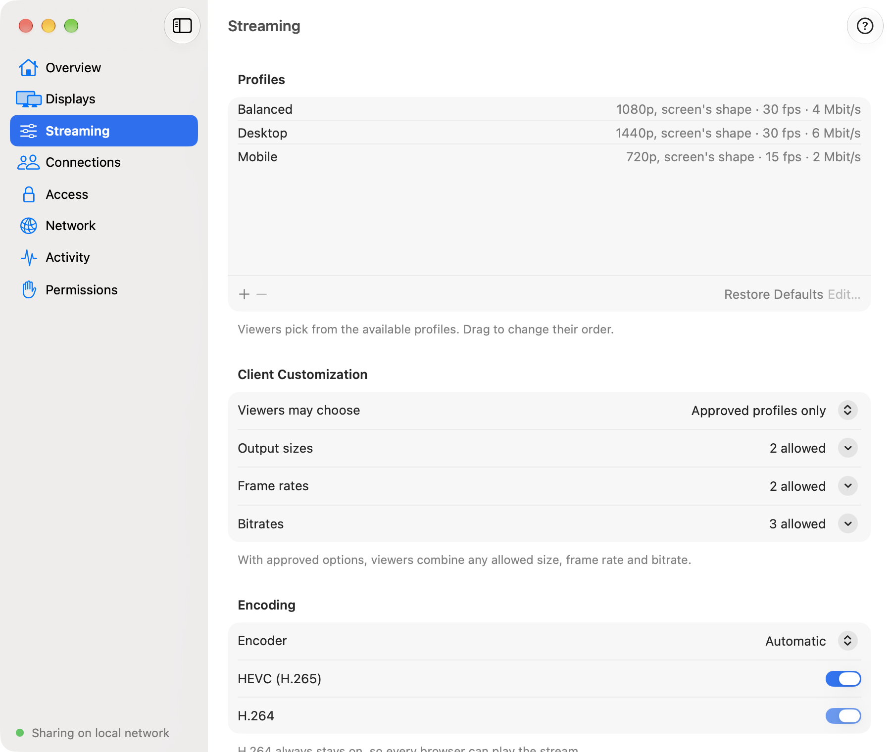
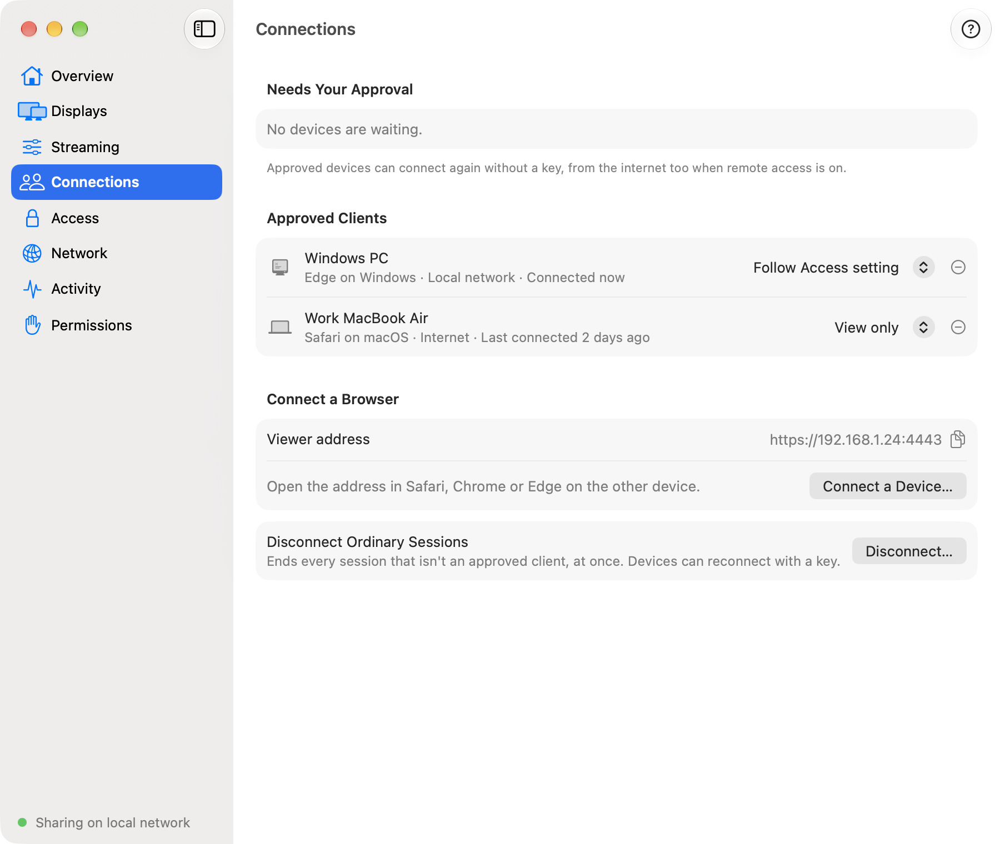
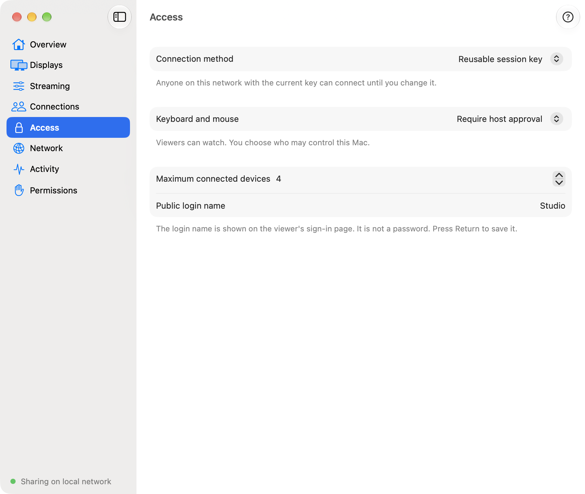
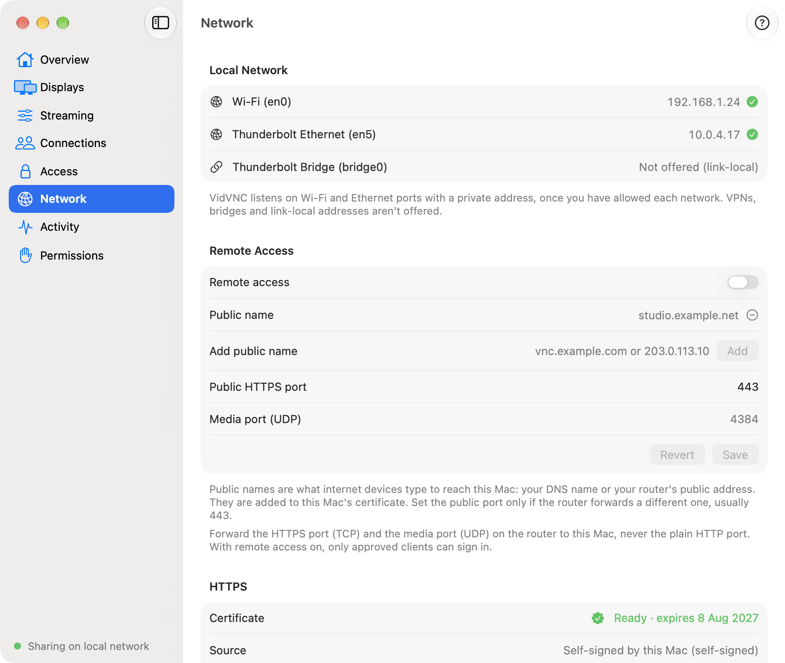
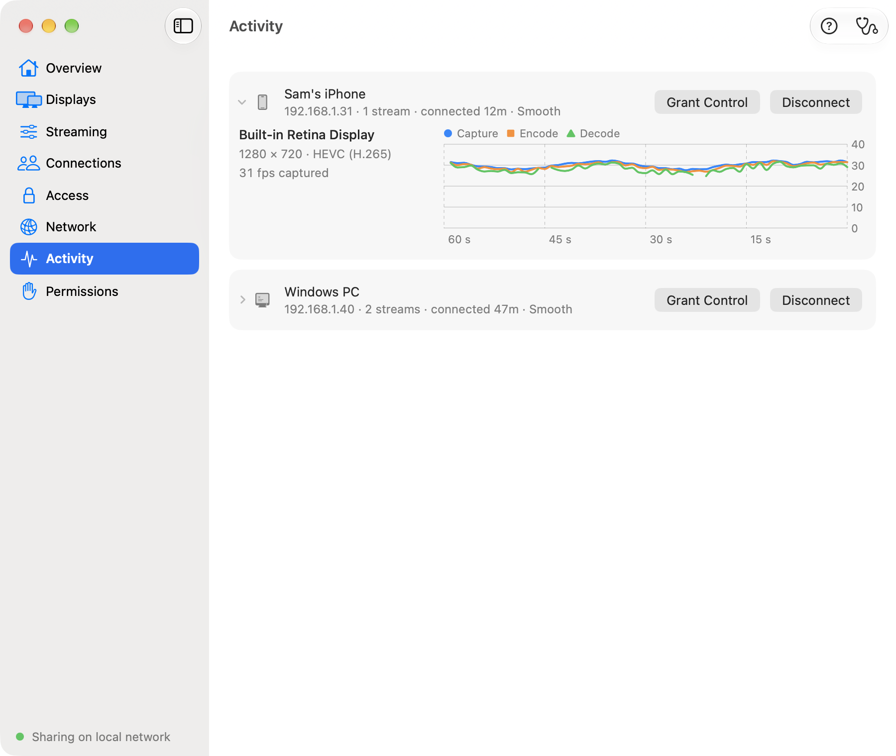
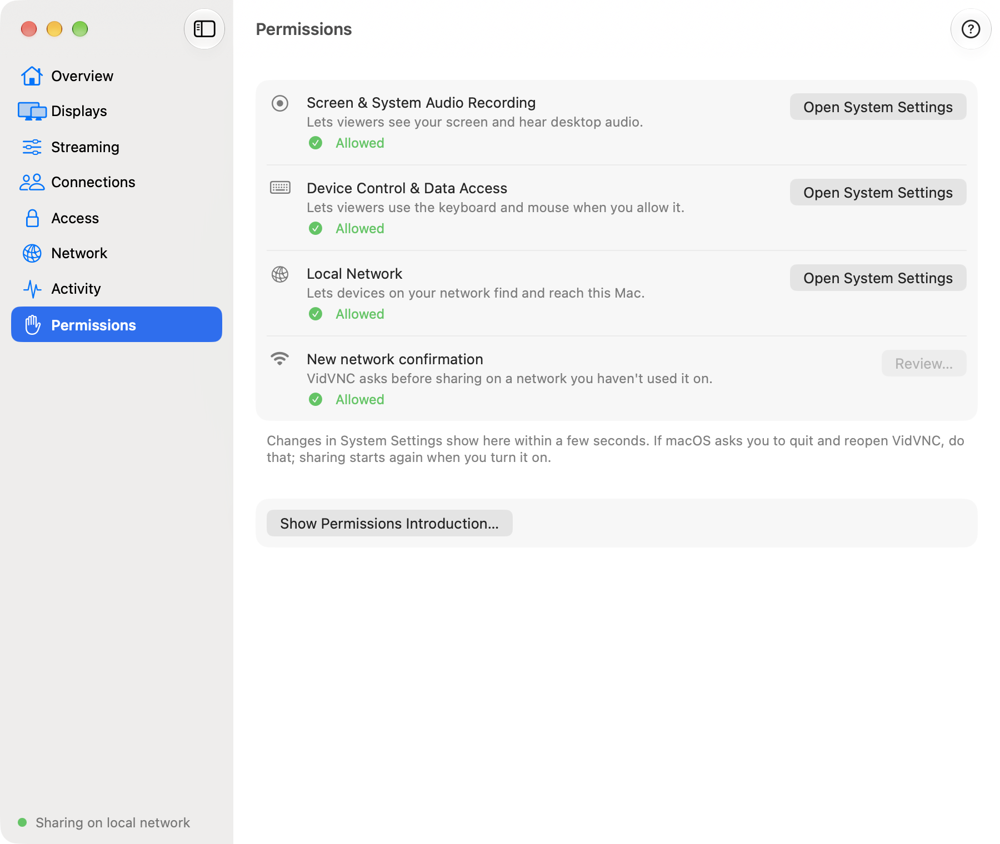
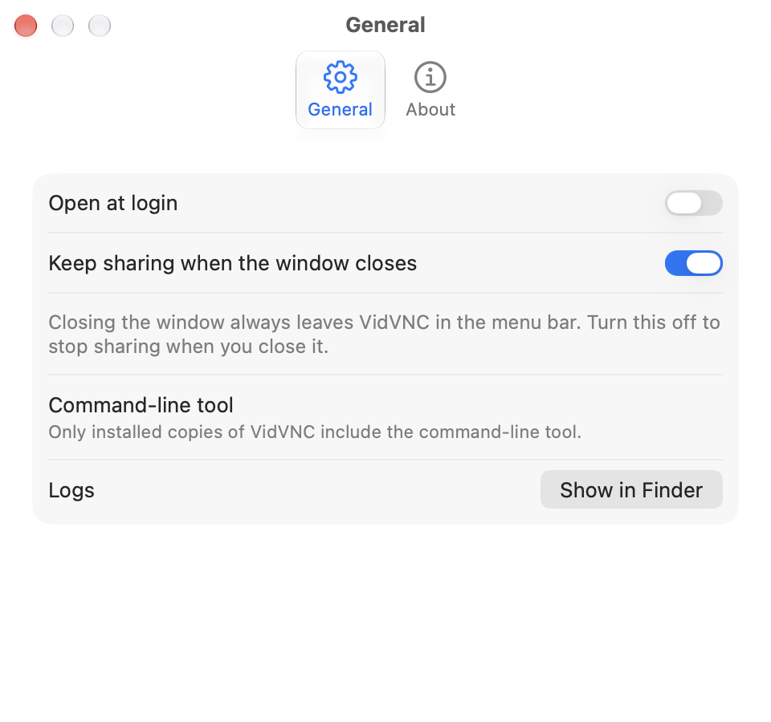

# Native macOS server host

Status: the VidVNC app for Mac runs from source and drives the real server, and
[packaging/macos](../../packaging/macos/README.md) builds it into a signed, notarized DMG.

The host owns the Mac's server-management UI and the server process's lifetime: Swift 6,
SwiftUI with AppKit where SwiftUI falls short (the Identify overlays), macOS 27 on Apple
Silicon. It speaks the [owner protocol](../../docs/ARCHITECTURE.md#owner-protocol) unchanged,
as the Windows host does. The design is
[2026-10-11-macos-host-design.md](../../docs/superpowers/specs/2026-10-11-macos-host-design.md);
the screens are in [docs/design/macos-host-previz/](../../docs/design/macos-host-previz/README.md).

## Using the app

Open **VidVNC** from Applications. The first time you turn sharing on, it explains the
permissions macOS will ask for (see [Mac permissions](../../README.md#on-a-mac)). The sections
are in the sidebar, and the bottom of the sidebar says whether sharing is on; ⌘1 to ⌘8 jump to
them. Closing the window leaves VidVNC in the menu bar, whose menu can start or stop sharing,
start with remote access, connect a device, open the window or quit. These screenshots come
from the app's sample data ([docs-screenshots.sh](docs-screenshots.sh)) and follow your
GitHub theme; all of them are in [docs/images](../../docs/images/README.md).

### Overview

<p align="center"><picture>
  <source media="(prefers-color-scheme: dark)" srcset="../../docs/images/macos-host/overview-dark.png">
  
</picture></p>

- The **VidVNC** switch next to **Screen Sharing** turns sharing on and off; the line below
  it says whether it is running and where.
- **Connect a Device…** shows the address and a key or QR code for another device (below).
- **Displays**, **Connection Details** (the computer name, viewer address and local hostname,
  with a copy button) and **Access** summarise the other sections; select a row to go there.
- **Connected Clients** lists who is connected; **View All** opens Activity.

### Connect a Device

<p align="center"><picture>
  <source media="(prefers-color-scheme: dark)" srcset="../../docs/images/macos-host/connect-device-qr-dark.png">
  
</picture></p>

1. Choose **Connect a Device…** on Overview, on Connections or in the menu bar.
2. Pick how the device connects: **Use the session key**, **Create a one-time key** (works
   once, for a few minutes) or **Approve this client** (the device becomes an approved
   client after one sign-in). Which ones are offered depends on the connection method in
   Access. Choose **Continue**.
3. On the other device, scan the QR code with the camera, or open the address and enter the
   code. On an iPhone or iPad, use Safari.

**New Key** replaces the session key, so devices using the old one can't sign in with it
again. **Back** returns to the choices; **Done** closes the sheet.

### Displays

<p align="center"><picture>
  <source media="(prefers-color-scheme: dark)" srcset="../../docs/images/macos-host/displays-dark.png">
  
</picture></p>

Your displays as they are arranged. Select one to change how it is shared.

- **Share this display** chooses whether viewers can see it, and **Default profile** which
  streaming profile they start with on it.
- **Host Defaults** sets the default profile for every display and **Share desktop audio**.
- **Identify** in the toolbar shows each display's number on its screen; the numbers match
  the viewer's display list.

Choose **Apply** to save the changes, or **Cancel**.

### Streaming

<p align="center"><picture>
  <source media="(prefers-color-scheme: dark)" srcset="../../docs/images/macos-host/streaming-dark.png">
  
</picture></p>

- **Profiles** are what viewers pick from, in this order: drag to reorder, **+** and **−** to
  add or remove, **Edit…** to change one, **Restore Defaults** for the built-in set.
- **Client Customization**: **Approved profiles only**, or **Approved options**, where
  viewers combine any allowed output size, frame rate and bitrate.
- **Encoding**: the encoder and which codecs are offered. H.264 always stays on, so every
  browser can play the stream.

Devices whose streams change reconnect to them.

### Connections

<p align="center"><picture>
  <source media="(prefers-color-scheme: dark)" srcset="../../docs/images/macos-host/connections-dark.png">
  
</picture></p>

- **Needs Your Approval**: devices that signed in with a setup code wait here; choose
  **Approve** or **Reject**.
- **Approved Clients** connect again without a key, from the internet too when remote access
  is on. The menu next to each sets what it may do with the keyboard and mouse (**Follow Access
  setting**, **Require host approval**, **Allow when available** or **View only**); **⊖**
  removes it.
- **Connect a Browser** shows the viewer address and **Connect a Device…**.
- **Disconnect Ordinary Sessions** ends every session that isn't an approved client.

### Access

<p align="center"><picture>
  <source media="(prefers-color-scheme: dark)" srcset="../../docs/images/macos-host/access-dark.png">
  
</picture></p>

- **Connection method**: **Reusable session key**, **One-time connection keys** or
  **Approved clients only**. With remote access on, only approved clients can sign in.
- **Keyboard and mouse**: **Require host approval** (you grant control in Activity) or
  **Allow when available** (a viewer takes control when nobody else has it).
- **Maximum connected devices**, and the **Public login name** shown on the viewer's
  sign-in page (press Return to save it; it is not a password).

### Network

<p align="center"><picture>
  <source media="(prefers-color-scheme: dark)" srcset="../../docs/images/macos-host/network-dark.png">
  
</picture></p>

- **Local Network** lists the Mac's networks and whether VidVNC offers itself on each. It
  listens on Wi-Fi and Ethernet ports with a private address once you have allowed each
  network; VPNs, bridges and link-local addresses aren't offered.
- **Remote Access** turns on access from the internet (approved clients only) and holds the
  public names, the public HTTPS port and the media port to forward on your router. Choose
  **Save** after changing them.
- **HTTPS** shows the certificate, where it comes from and its fingerprint, with
  **Regenerate…** and **Show Enrolment QR Code…** for installing it on another device.

### Activity

<p align="center"><picture>
  <source media="(prefers-color-scheme: dark)" srcset="../../docs/images/macos-host/activity-dark.png">
  
</picture></p>

Who is connected and how their streams are doing. Expand a device to see each stream's size,
codec, frame rate and a graph of the last 60 seconds.

- **Grant Control** lets that device use the keyboard and mouse; **Take Back Control** ends
  it. One device can control at a time.
- **Disconnect** ends that device's session.
- **Diagnostics** in the toolbar opens live diagnostics in your browser.

### Permissions

<p align="center"><picture>
  <source media="(prefers-color-scheme: dark)" srcset="../../docs/images/macos-host/permissions-dark.png">
  
</picture></p>

Each macOS permission VidVNC uses and whether it is allowed. **Open System Settings** opens
the right pane; changes show here within a few seconds.

- **Screen & System Audio Recording**: viewers see the screen and hear desktop audio.
- **Device Control & Data Access**: viewers use the keyboard and mouse when you allow it.
- **Local Network**: devices on your network can reach the Mac.
- **New network confirmation**: VidVNC asks before sharing on a network you haven't used it
  on; **Review…** answers a waiting one.

**Show Permissions Introduction…** shows the explanation from the first start again.

### Settings

<p align="center"><picture>
  <source media="(prefers-color-scheme: dark)" srcset="../../docs/images/macos-host/settings-general-dark.png">
  
</picture></p>

**VidVNC > Settings…** (⌘,): **Open at login**, **Keep sharing when the window closes**
(turn it off to stop sharing when you close the window), the command-line tool, and **Show
in Finder** for the logs. **About** lists the versions of VidVNC, the server, Node.js,
GStreamer and macOS, with **Copy Versions**.

## Layout

| Path                                                | What it holds                                                                                                                                                                       |
| --------------------------------------------------- | ----------------------------------------------------------------------------------------------------------------------------------------------------------------------------------- |
| `VidVNC.xcodeproj`                                  | The app, its unit tests and its UI tests; the shared `VidVNC` scheme                                                                                                                |
| `VidVNC/Model/`                                     | `HostModel`, the protocol every view reads, and `FakeHostModel`, its sample-data stand-in for previews, screenshots and `-scenario`                                                 |
| `VidVNC/Server/`                                    | `ServerHostModel` (the real model), `ServerProcess` (`posix_spawn` with pipes), `RuntimeManifest`, the owner-protocol messages, and `OfflineSettings` (`main.mjs config`)           |
| `VidVNC/System/`                                    | Privacy checks, the Local Network probe, display ids, network interfaces, the login item, Install Command-Line Tool                                                                 |
| `VidVNC/Views/`, `Sheets/`, `Settings/`, `MenuBar/` | The window's eight sections, its sheets, the Settings window and the menu bar item                                                                                                  |
| `VidVNCTests/`                                      | Swift Testing unit tests: every owner-protocol example decodes, the manifest's path rules, `ServerProcess`                                                                          |
| `VidVNCUITests/`                                    | XCUITest navigation against the stand-in server                                                                                                                                     |
| `tests/`                                            | The stand-in server, its contract check (part of `npm test`) and the process-tree check                                                                                             |
| `Config/`                                           | `Info.plist` additions and the signing settings                                                                                                                                     |
| `screenshots.sh`                                    | Saves light and dark images of each section to `docs/design/macos-host-previz/`                                                                                                     |
| `docs-screenshots.sh`                               | Saves the whole window of each section, Connect a Device's QR code and each Settings tab, light and dark, to `docs/images/macos-host/` ([Screenshots](../../docs/images/README.md)) |

## Run it

From the repository root, on a Mac with the tools `npm run deps` asks for:

```sh
npm run prepare:host -- Debug
npm run start:host -- Debug
```

`prepare:host` builds and tests the Debug media worker, builds the app into
`out/macos-host/DerivedData`, and writes the development runtime manifest to
`out/macos-host/Debug/runtime.json`. `start:host` does the same when something is stale, then
opens the app through Launch Services, so macOS asks for and records permissions for VidVNC
rather than for Terminal. To debug in Xcode, open `VidVNC.xcodeproj` and run the `VidVNC`
scheme: its Run action points `VIDVNC_RUNTIME_MANIFEST` at the same manifest. Enable the
scheme's `VIDVNC_INSPECT` variable for the Node inspector on `127.0.0.1:9229`.

**Signing.** The project signs ad-hoc unless told otherwise, which works but loses the Screen
Recording and Device Control grants on every rebuild. Set `VIDVNC_SIGN_IDENTITY` (for example
`Developer ID Application`) for `prepare:host` and `start:host`; the team comes from the
matching identity in your keychain at build time, or from `VIDVNC_DEVELOPMENT_TEAM`. Or copy
`Config/Signing.local.xcconfig.example` to `Config/Signing.local.xcconfig` for Xcode. Both
stay out of the repository.

The app's bundle ID is `io.github.kiforsbe.vidvnc` (spec Q14). Settings and logs are the
server's, in `~/Library/Application Support/VidVNC`; the app keeps only its own preferences
(keep sharing when the window closes, whether the permissions introduction was shown) in
its user defaults.

## How it works

- The server starts with `--desktop --await-owner --confirm-networks` and gets one approval
  line, `{"type":"start","sharing":"local"}` or `"remote"`. After `ready`, every change is
  an owner command; while sharing is off, Access and Remote Access settings go through the
  offline `config` command, and the stream policy can be changed only while sharing.
- The server runs in its own process group with only stdin, stdout and stderr inherited.
  The host alone holds the write end of the server's stdin, so if the host exits or is
  killed the server stops (owner pipe and parent watch). Stop sends `{"type":"stop"}` and
  ends the process group after five seconds; Quit waits for that.
- Closing the window leaves VidVNC in the menu bar with no Dock icon, and sharing carries
  on unless **Keep sharing when the window closes** is off in Settings, General.
- Permissions (spec D5): nothing is asked at launch. Turning sharing on the first time shows
  an introduction, then macOS asks for Screen & System Audio Recording and Local Network,
  and the first stream with sound asks for System Audio Recording. Device Control & Data
  Access is explained the first time the owner gives a viewer control or picks
  **Allow when available**; until it is allowed, the worker posts no input and the server
  reports why on that stream. The Permissions section reads each setting every two seconds.
  Local Network has no API; it is inferred by browsing for `_vidvnc._tcp`.
- Streaming edits the profiles, codecs and encoder while sharing. A profile's size follows
  the display, as with the command line's `--height`, `--width`, `--scale` and
  `--size … --aspect`; **Restore Defaults** puts the five standard profiles back as shipped
  and keeps the owner's own.
- Once the introduction has been shown, sharing starts when the app opens, as on Windows,
  if Screen Recording is already allowed; otherwise the app opens with sharing off and asks
  nothing. `-startSharing NO` turns that off (the UI tests pass it), and the unit tests'
  host app never shares.
- The app icon is the Windows host's monitor glyph on a macOS tile, drawn by
  `Icon/draw-app-icon.swift` into `VidVNC/Assets.xcassets`.
- A network the server has not been allowed on shows a sheet, **Share on This Network?**,
  and the server listens there only after **Allow** (`network-confirm`, Q2).
- **Open at login** in Settings, General registers the app as a login item with
  `SMAppService`; it is off until the owner turns it on.
- **Install Command-Line Tool…** (the VidVNC menu, or **Command-line tool** in Settings,
  General) links `/usr/local/bin/vidvnc` to the packaged app's `Contents/Helpers/vidvnc`
  after the owner confirms, directly when that folder is writable and otherwise through
  `do shell script … with administrator privileges`, which shows macOS's password prompt.
  It can replace another `vidvnc` there after saying so, and **Remove** deletes the link
  only while it leads to this app. A development build has no launcher, so the item is
  unavailable there.
- A packaged app reads `Contents/Resources/runtime.json`, whose `root` is `..`, and never a
  `VIDVNC_RUNTIME_MANIFEST` it inherits.
- In Debug builds, `-scenario "Remote access"` (any Scenario menu title) runs the app on
  sample data with no server, with a Scenario menu to switch states.

## Tests

```sh
xcodebuild -project apps/macos-host/VidVNC.xcodeproj -scheme VidVNC \
  -destination 'platform=macOS,arch=arm64' -derivedDataPath out/macos-host/DerivedData test
node apps/macos-host/tests/process-tree.mjs
node apps/macos-host/tests/process-tree.mjs --real
```

The Xcode tests run the unit tests and the UI tests; the UI tests need
`npm run prepare:host -- Debug` first (for the manifest's Node.js path) and Xcode's
permission to control the Mac. They start sharing against the stand-in server, so nothing is
captured. `process-tree.mjs` starts sharing, kills VidVNC with `SIGKILL` and fails if any
server process is still running ten seconds later; `--real` uses the real server and its
media relay. Both use a Debug-only switch (`VIDVNC_TEST_ASSUME_SCREEN_RECORDING=1`) in place
of the Screen Recording permission, because no viewer connects and nothing is captured.

## Not done yet

- The server reports only networks waiting for an answer, so the app cannot list or forget
  networks already allowed; `known-networks.json` in the settings folder holds them.
