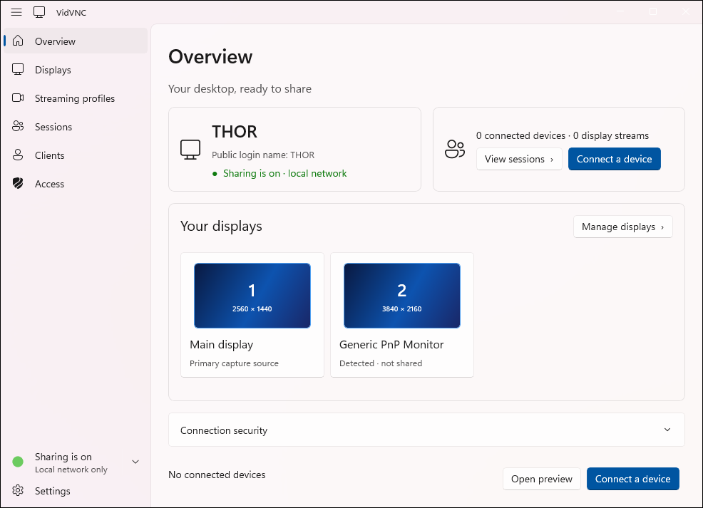
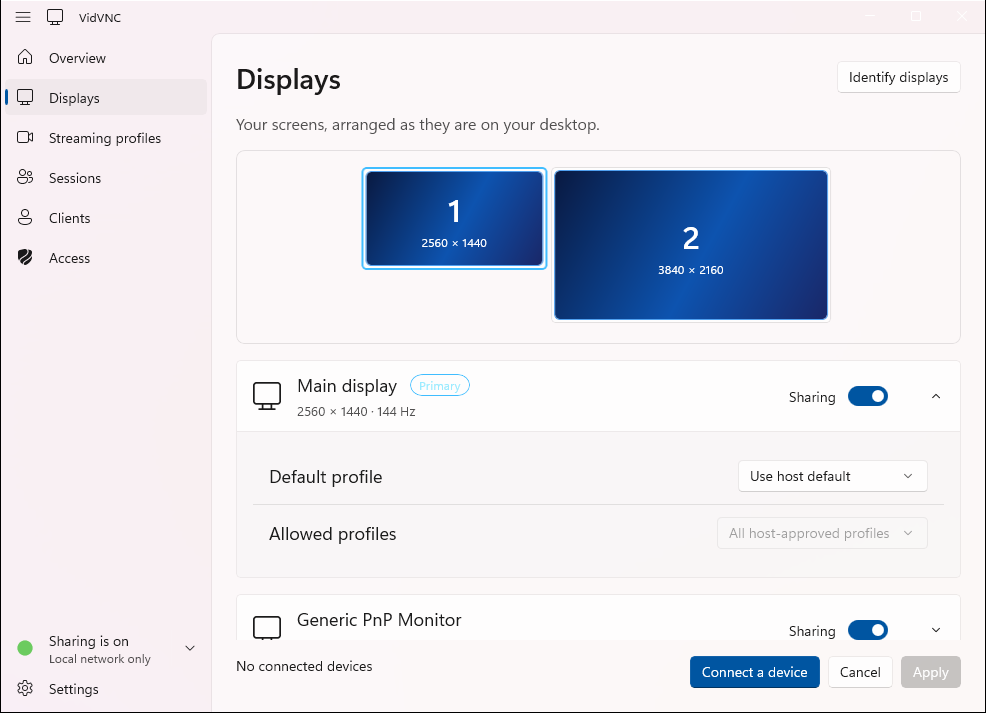
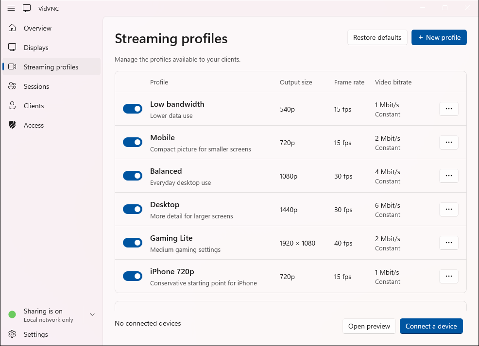
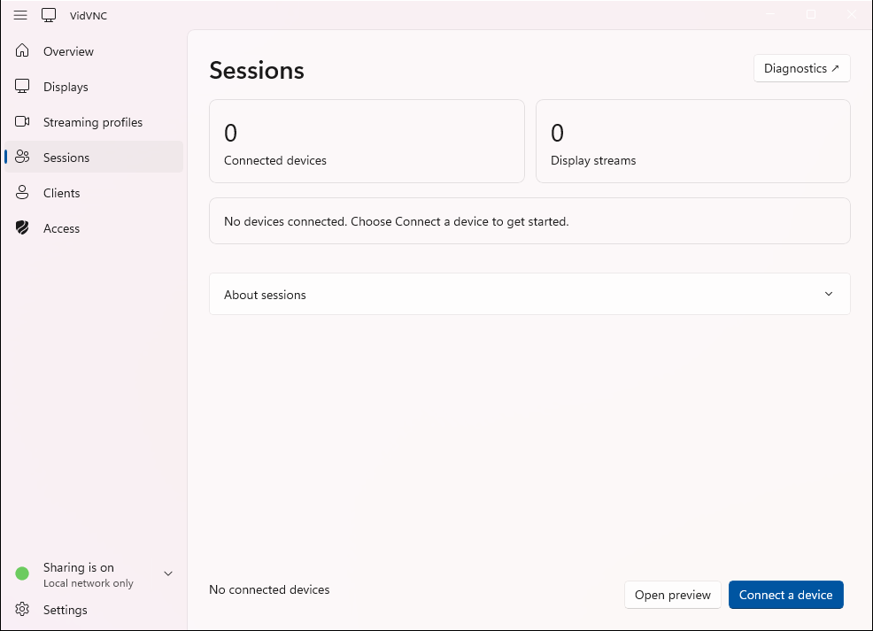
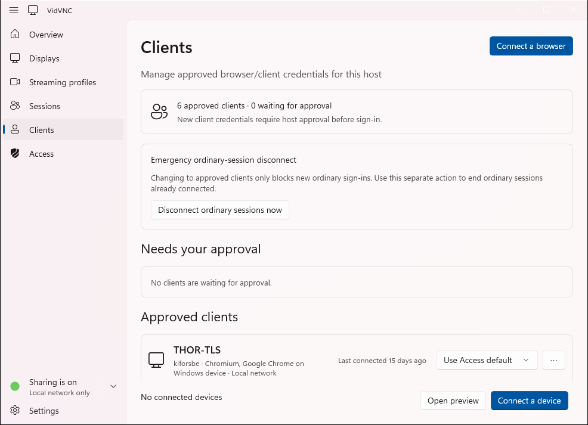
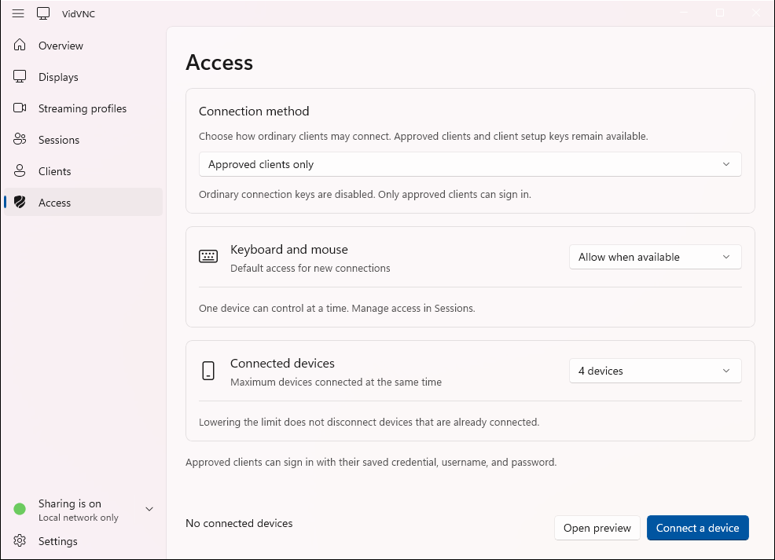
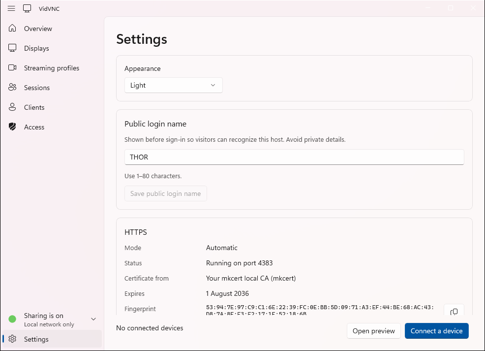
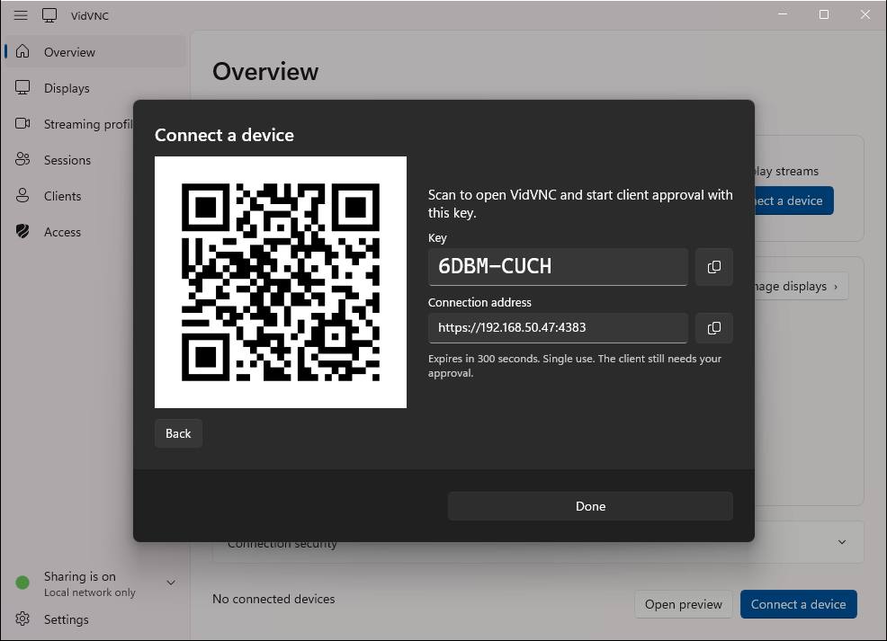

# Native Windows server host

Status: the VidVNC app for Windows, a WinUI 3 app on .NET 10 that owns the PC's
server-management UI and the server process's lifetime. It speaks the
[owner protocol](../../docs/ARCHITECTURE.md#owner-protocol), as the
[Mac host](../macos-host/README.md) does. Installing it is in
[Install and run](../../README.md#vidvnc-app), and building and running it from source in
[Build and run (Windows)](../../README.md#build-and-run-windows): `npm run prepare:host`, then
`npm run start:host`.

| Path                     | What it holds                                                                                                                                  |
| ------------------------ | ---------------------------------------------------------------------------------------------------------------------------------------------- |
| `VidVnc.Host.csproj`     | The app project; `npm run build:host` builds it                                                                                                |
| `HostWindow*.cs`         | The window, one file per page or concern (Overview, Displays, Profiles, Sessions, Clients, Access, TLS, the notification-area icon and others) |
| `ServerJob.cs`           | The job object that ends the server's processes with the host, even on a forced exit                                                           |
| `RuntimeManifest.cs`     | Reads the runtime manifest: where Node.js, the server and the media worker are, and the prerequisites                                          |
| `tests/Navigation/`      | The WinUI navigation regression ([README](tests/Navigation/README.md))                                                                         |
| `tests/RuntimeContract/` | Runtime manifest and job object checks (`npm run test:host`)                                                                                   |

## Screenshots

Every page, light or dark to match your GitHub theme, taken from the Debug host by `npm run screenshot:host` ([all images](../../docs/images/README.md)).

<table>
  <tr>
    <td align="center"><picture><source media="(prefers-color-scheme: dark)" srcset="../../docs/images/windows-host/overview-dark.png"></picture> Overview</td>
    <td align="center"><picture><source media="(prefers-color-scheme: dark)" srcset="../../docs/images/windows-host/displays-dark.png"></picture> Displays</td>
  </tr>
  <tr>
    <td align="center"><picture><source media="(prefers-color-scheme: dark)" srcset="../../docs/images/windows-host/streaming-profiles-dark.png"></picture> Streaming profiles</td>
    <td align="center"><picture><source media="(prefers-color-scheme: dark)" srcset="../../docs/images/windows-host/sessions-dark.png"></picture> Sessions</td>
  </tr>
  <tr>
    <td align="center"><picture><source media="(prefers-color-scheme: dark)" srcset="../../docs/images/windows-host/clients-dark.png"></picture> Clients</td>
    <td align="center"><picture><source media="(prefers-color-scheme: dark)" srcset="../../docs/images/windows-host/access-dark.png"></picture> Access</td>
  </tr>
  <tr>
    <td align="center"><picture><source media="(prefers-color-scheme: dark)" srcset="../../docs/images/windows-host/settings-dark.png"></picture> Settings</td>
    <td align="center"><picture><source media="(prefers-color-scheme: dark)" srcset="../../docs/images/windows-host/connect-device-qr-dark.png"></picture> Connect a device: QR code</td>
  </tr>
</table>
