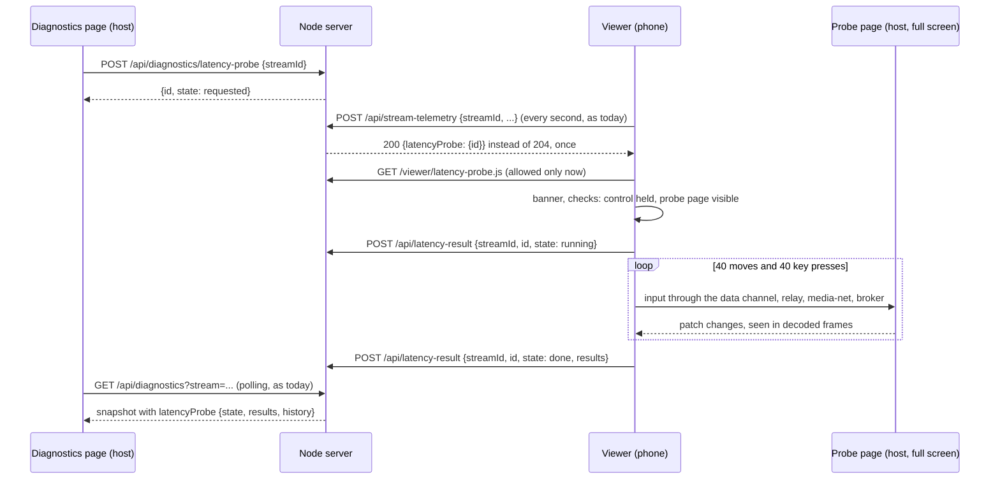
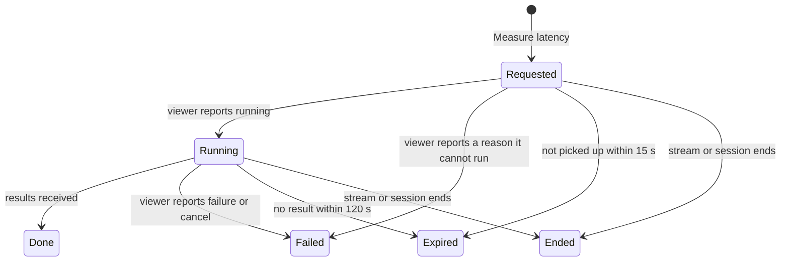

# Latency probe from Diagnostics — design

Date: 2026-10-14. Status: draft for the owner's review.

## Goal

Measure hand-to-glass and glass-to-glass latency on a real viewer, including an iPhone, and
read the results on the host, without the measurement being present, visible or costing
anything in a normal session.

The first probe (commit `b1ebf9b`) works, but it is the wrong shape for that:

- It is turned on from the viewer (`?latency-probe`) and shows its panel there, so a phone
  user has to copy JSON off the phone to report results.
- `viewer/app.js` imports the probe module statically, so every viewer downloads it.
- While its panel exists it reads every presented frame, and its canvas uses
  `willReadFrequently`, which can make the browser copy the whole decoded frame to system
  memory before scaling it.
- Its README says "single-stream sessions only"; in fact the real server always runs the
  viewer in streams mode, where the probe measures the stream the viewer is showing.

## Decisions agreed with the owner

1. **The host starts it.** A **Measure latency** action on the Diagnostics page, for the
   stream selected there, is the only way to start a measurement. The `?latency-probe` panel
   is removed.
2. **Nothing in a normal session.** The viewer does not import the probe module. It loads
   it only when the server asks for a measurement, and the server serves the module only to
   a session with a measurement pending or running.
3. **The phone starts automatically**, showing a small banner with **Cancel** only while it
   runs. No other probe UI exists on the viewer.
4. **Frames are read only during a run**, on a GPU-backed canvas, and each run reports its
   own overhead (time spent per frame, frames the callback skipped).
5. **Results travel back to the server** and appear in Diagnostics; the viewer never shows
   them.
6. **Delivery uses the existing stream-telemetry exchange**: no new push channel, no change
   to the native worker, media-net or the data channel.

## Out of scope

- Splitting the host-side stages (capture, encode, pipe, media-net, relay). A later step,
  if the end-to-end numbers call for it.
- Starting a measurement from the command line.
- Measuring more than one stream at a time, or the audio path.

## Flow

A measurement's states, held by the server:

## Server

**A new module, `latency-probes.mjs`**, owns measurements. One measurement at a time per
server: a request while one is requested or running is refused ("A measurement is already
running"). Each has a random id (128 bits, base64url), the stream id, the session it
belongs to, its state, times, and a result or a reason. It keeps the last five finished
measurements per stream for Diagnostics, in memory only; nothing is written to disk.

**Diagnostics listener ([diagnostics-http.mjs](../../../apps/server/src/diagnostics-http.mjs)).**
A new route, `POST /api/diagnostics/latency-probe`, body `{streamId}` (at most 1 KiB). It
has the listener's existing checks (loopback peer, `127.0.0.1` or `localhost` Host, allowed
Origin) plus the diagnostics bearer, and additionally requires an `Origin` header, because
it is the listener's first state-changing route. It answers `202 {id, state}`, `404` for an
unknown stream, `409` while another measurement is active. `GET /api/diagnostics` adds a
`latencyProbe` field for the selected stream: the active measurement, if any, and its
history. The page's CSP already allows `connect-src 'self'`.

**Viewer listener ([http-app.mjs](../../../apps/server/src/http-app.mjs)).**

- `/api/stream-telemetry`: when a measurement is `requested` for this session and stream,
  the reply is `200 {latencyProbe: {id}}` instead of `204`, once. Everything else about the
  route is unchanged.
- `/viewer/latency-probe.js` stays in `VIEWER_ASSETS`, but is served only when the viewer
  grant is valid **and** its session has a measurement requested or running. Otherwise it
  is a 404, the same as an unknown file. This needs the grant check to give back the
  session it belongs to, not only a yes or no.
- A new route, `POST /api/latency-result`, with the session bearer like the other viewer
  routes, at most 8 KiB. Body: `{streamId, id, state, reason?, results?}`. The id must
  match the session's active measurement for that stream, or it is a 404. `state` is one
  of `running`, `done`, `failed`; `reason` is one of a fixed set (`no-control`,
  `no-probe-page`, `unsupported`, `cancelled`, `stream-changed`, `control-lost`);
  `results` is validated field by field (below). Anything else is a 400 and fails the
  measurement. Allowed on the local network and from the internet alike, as the stream
  routes are.
- A session or stream that ends ends its measurement.

**Results schema.** Every timing is an object `{count, min, median, p95, max}` of finite
numbers between 0 and 60,000 ms with `count` an integer of at most 1,000, or `{count: 0}`:
`handToGlassMs.move`, `handToGlassMs.key`, `handToReceiveMs.move`, `handToReceiveMs.key`,
`glassToGlassMs`; glass-to-glass alone may run from -60,000, because from another device it
includes the offset between the two clocks. `timeouts.move` and `timeouts.key` are integers up to 1,000. `overhead`
is `{callbackMs: <timing>, skippedFrames: integer}`. `receiver` holds the numeric fields
`decodeFps`, `jitterBufferMs`, `decodeMs`, `rttMs`, `lostInterval`, `framesDropped`, each a
finite number or null. `video` is `{width, height}`, integers up to 16,384. `browser` is a
string of at most 200 characters, shown on the page as text only. Unknown fields are a 400.

## Viewer

- **No static import.** `viewer/app.js` drops its import of the probe and the
  `?latency-probe` panel, with its styles. A normal session never fetches the module.
- **Receiving a request.** `StreamSubscriptions` passes a `latencyProbe` found in a
  `stream-telemetry` reply to the viewer, with the stream it came for. If a measurement is
  already running on this viewer, the new one fails with `stream-changed`.
- **Starting.** The viewer checks, in order, and reports the first failure as the reason:
  that it is showing that stream (`stream-changed`); that the browser has
  `requestVideoFrameCallback` (`unsupported`); that the module loads (`unsupported`); that it
  holds keyboard and mouse control (`no-control`); and that the probe page's barcode reads in
  a frame within 2 seconds (`no-probe-page`). It then reports `running`.
- **The banner.** "Measuring latency for the host. Keep your hands off the screen." with
  **Cancel**, at the top of the stage, also in immersive mode. Cancel, a lost control lease
  or switching stream stops the run and reports `cancelled`, `control-lost` or
  `stream-changed`. The banner goes when the run ends. The viewer shows no results.
- **The run.** As in the first probe: 40 pointer moves and 40 presses of L, alternating,
  with random pauses of 150 to 400 ms, each timed to the first frame that shows its change
  (`expectedDisplayTime`), and a stop after the first key press that doesn't flip the patch
  (`no-probe-page`). Frames are read only between start and end.
- **Reading frames.** The canvas is GPU-backed (no `willReadFrequently`), so the browser
  scales the frame on the GPU and only the 128 × 72 result is read back.
- **Overhead.** Each frame callback is timed, and `presentedFrames` is compared between
  callbacks to count frames the callback missed. Both go into `overhead`; a missed frame
  means a change may have been seen up to one frame late.
- **Reporting.** `done` with the results, through `POST /api/latency-result`. A failed post
  is not retried; the server expires the measurement.

## Diagnostics page

A **Latency** section under the stream picker
([diagnostics.html](../../../apps/web-client/src/diagnostics.html),
[diagnostics.js](../../../apps/web-client/src/diagnostics.js)):

- **Measure latency** starts a measurement for the selected stream, and is disabled while
  one is active anywhere. A one-line reminder says what the host needs: the probe page
  (`tools/debug/latency-probe.html`) full screen on the shared display, and the viewer
  holding keyboard and mouse.
- The state, from the snapshot the page already polls: waiting for the viewer, measuring,
  done, or the failure in words ("The viewer doesn't have keyboard and mouse control", "The
  probe page isn't visible on the shared display", and so on).
- Results as a table: moves and key presses, hand-to-glass and to last packet, each with
  median, p95, range and count; glass-to-glass with the note that it is exact only when the
  viewer runs on the host; the receiver figures; the overhead; the browser and video size.
  The last five runs are listed below, newest first, and **Copy as JSON** copies one.

## Security

**New entry points.** `POST /api/diagnostics/latency-probe` on the loopback diagnostics
listener, and `POST /api/latency-result` on the viewer listener. Both are added to the
attack-surface table in the security architecture.

**What the diagnostics bearer can now do.** Until now it could only read. With this change,
whoever holds it can ask a connected viewer to run a measurement. The viewer then sends
pointer moves to two fixed points and presses of L, through the normal input path, and only
while that viewer already holds keyboard and mouse control: the broker's lease, allow-lists
and rate limit all still apply. The viewer shows the banner throughout and can cancel. The
bearer is already short-lived, issued only by the host and the local CLI, and sent only to
`127.0.0.1`. New threat-model row: _a stolen diagnostics bearer makes a controlling viewer
send probe input_; mitigations as above; residual: up to about a minute of moves and L
presses on the host, visible on the viewer.

**What a viewer can now send.** A results body, which is validated strictly (fixed fields,
bounded numbers, a capped browser string rendered as text). It is accepted only for that
session's active measurement id, which the viewer learned from the server; a viewer cannot
create a measurement or write into another session's. New threat-model row: _a viewer sends
forged or hostile results_; mitigation: schema and size limits, text rendering, memory
only; residual: misleading numbers in Diagnostics.

**Least exposure.** The probe module is served only to a session with an active
measurement, so it is not reachable by any other session. Nothing is written to disk, and
results never go to another viewer.

## Documentation

In the same change, per [AGENTS.md](../../../AGENTS.md): the security architecture (attack
surface, threat model, the diagnostics section), the architecture's Diagnostics section and a
sequence diagram, [tools/debug/README.md](../../../tools/debug/README.md#latency-probe)
(rewritten around Diagnostics, and corrected: the probe measures the stream the viewer
shows, in streams mode), the changelog entry for the probe (replaced, since it is
unreleased), and the README's diagnostics paragraph.

## Testing

- **Server unit tests:** the measurement states and timeouts; one measurement at a time;
  the telemetry reply carries the request once; the module is served only while a
  measurement is active for that session; result validation (each field's bounds, unknown
  fields, wrong id, other session, ended stream); the diagnostics route's checks (no bearer,
  no Origin, wrong Origin, unknown stream, busy).
- **Viewer unit tests:** the existing pure helpers; the order of the start checks and the
  reason each reports; building the results body to the schema.
- **Browser check:** extend the existing Playwright viewer check: a normal session fetches
  no `latency-probe.js`; after a request it does, the banner shows, and a cancel reports
  `cancelled`.
- **By hand:** a real run from Diagnostics with the viewer on the host and on an iPhone,
  checked once against a 240 fps camera recording.

## Risks

- **Safari and pixel reads.** Safari supports `requestVideoFrameCallback` and drawing a
  WebRTC video to a canvas, but if it reports a zero video size or refuses the read, the run
  fails with `unsupported`. Not yet tried on an iPhone.
- **Overhead on slow phones.** If the frame callback overruns, changes are seen late; the
  overhead figures make that visible rather than hidden.
